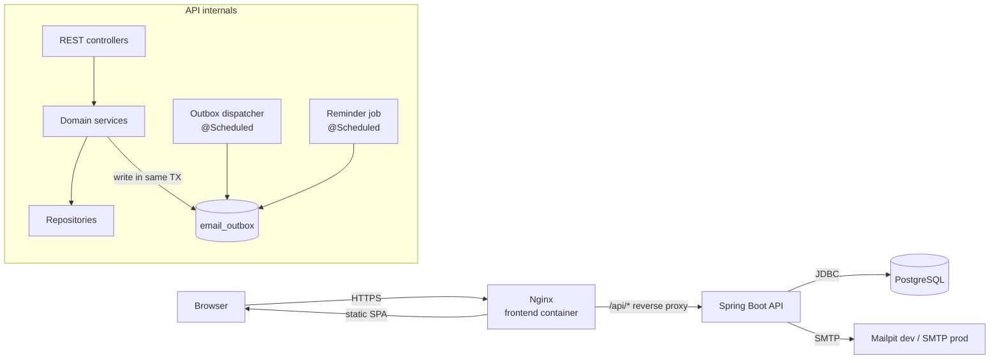
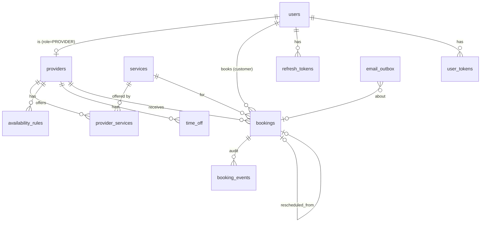
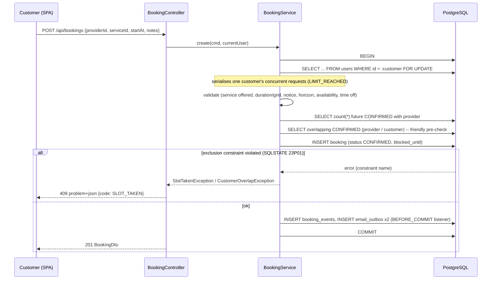
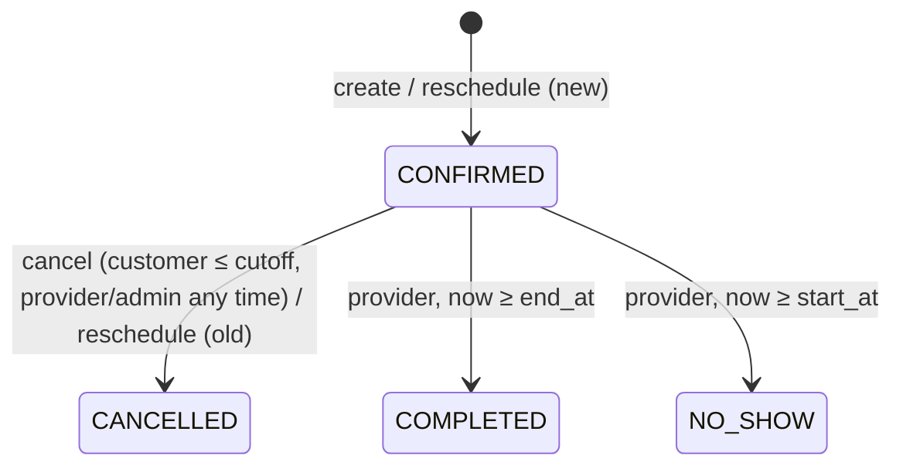

# Appointment Booking — Technical Design

| | |
|---|---|
| **Status** | Draft v0.1 |
| **Last updated** | 2026-10-22 |
| **Product spec** | [PRODUCT.md](./PRODUCT.md) |

This document describes **how** the system in [PRODUCT.md](./PRODUCT.md) will be built. Requirement IDs (`FR-n`, `C1`, …) refer to that document.

---

## 1. Assumptions for open product questions

PRODUCT.md §12 has open questions. This design assumes the answers below. If an answer changes, the sections listed need revisiting.

| # | Question | Assumption | Affects |
|---|---|---|---|
| 1 | Guest booking? | **No.** Customers must have an account. | §5, §8 |
| 2 | Per-provider service durations/prices? | **No.** Duration is set on the service and is the same for every provider. No prices in v1. | §5.3 |
| 3 | Provider approval step? | **No.** Bookings are confirmed instantly. The status enum leaves room to add `PENDING` later. | §5.5, §6.4 |
| 4 | Timezones | **One timezone per provider.** The browser supplies the customer's timezone. | §6.1 |
| 5 | Production SMTP | **Any SMTP server**, configured with environment variables. | §7 |

---

## 2. Technology choices

| Layer | Choice | Why |
|---|---|---|
| Frontend | React 19 + TypeScript, Vite | Fast builds, type safety |
| Routing / data | React Router, TanStack Query | Built-in caching, refetching and invalidation of server data |
| Forms | React Hook Form + Zod | Validation schemas shared by all forms |
| UI | Tailwind CSS + shadcn/ui (Radix primitives) | Accessible components (WCAG AA, see NFRs) |
| Calendar UI | FullCalendar (provider week/day view) | Mature, keyboard accessible |
| Date/time (FE) | `date-fns` + `date-fns-tz` | Display in the viewer's timezone |
| API client | Generated from OpenAPI (`openapi-typescript` + `openapi-fetch`) | Frontend types match the backend |
| Backend | Java 21, Spring Boot 3.x | Matches the product spec |
| Persistence | Spring Data JPA (Hibernate), Flyway migrations | Versioned schema |
| Database | PostgreSQL 16 + `btree_gist` extension | Exclusion constraints for double-booking safety |
| Security | Spring Security, OAuth2 Resource Server (JWT, HS256) | Stateless auth (FR-2) |
| Email | Spring Mail (`JavaMailSender`), Thymeleaf templates | HTML + plain text (FR-21) |
| Rate limiting | Bucket4j (in-memory) | Protects login and booking endpoints |
| API docs | springdoc-openapi | Swagger UI and the spec for the generated client |
| Testing | JUnit 5, Testcontainers, GreenMail, Vitest, React Testing Library, Playwright | See §11 |
| Runtime | Docker, Docker Compose; Nginx serves the SPA | One-command startup (NFR) |

---

## 3. System architecture



- **Single deployable backend.** It is a modular monolith organized by feature. v1 has no message broker. Reliable email delivery comes from the transactional outbox (§7).
- **Nginx is the single entry point.** It serves the SPA and proxies `/api` to the backend, so the browser sees one origin. Production needs no CORS setup. In development, Vite proxies `/api`.
- **The backend is stateless.** It can scale horizontally. Scheduled jobs use `SKIP LOCKED` (§7.2), so they are safe on several instances.

---

## 4. Backend structure

The code is organized by feature. Each package holds its own controller, service, repository, entities and DTOs.

```
backend/src/main/java/com/appointmentprep/
├── AppointmentApplication.java
├── common/          # error handling (ProblemDetail), clock, base entity, pagination
├── config/          # security, JWT, OpenAPI, scheduling, CORS
├── auth/            # register, login, refresh, password reset, invites
├── user/            # User entity, profile endpoints
├── provider/        # Provider profile, availability rules, time off
├── catalog/         # ServiceOffering (the "Service" concept) + provider_services
├── slot/            # SlotService — computes free slots (no persistence)
├── booking/         # Booking aggregate, conflict checks, state machine, events
├── notification/    # Outbox, dispatcher, templates, ICS builder, reminder job
├── settings/        # Global configurable rules (cached)
└── admin/           # Admin-only endpoints (delegates to the feature services)
```

Conventions:
- **Naming.** The product term "Service" is `ServiceOffering` in code, so it doesn't clash with Spring's `@Service`. The table name is still `services`.
- **Time.** Code reads the current time from an injected `java.time.Clock`. Never call `Instant.now()` directly, so tests can freeze time.
- **DTOs.** Controllers accept and return Java `record` DTOs, never entities. Bean Validation (`@Valid`) runs on every request body.
- **Transactions.** Service methods own transaction boundaries (`@Transactional`). Controllers stay thin.
- **Events.** A booking state change publishes a Spring `ApplicationEvent`. A notification listener writes outbox rows **inside the same transaction** (`@TransactionalEventListener(phase = BEFORE_COMMIT)`).

---

## 5. Data model

### 5.1 Entity relationships



### 5.2 Schema (Flyway `V1__init.sql`, abridged)

```sql
CREATE EXTENSION IF NOT EXISTS btree_gist;
CREATE EXTENSION IF NOT EXISTS citext;

CREATE TABLE users (
  id             uuid PRIMARY KEY,
  email          citext NOT NULL UNIQUE,
  password_hash  varchar(100),                 -- null until invite accepted
  full_name      varchar(120) NOT NULL,
  role           varchar(20)  NOT NULL CHECK (role IN ('CUSTOMER','PROVIDER','ADMIN')),
  timezone       varchar(64)  NOT NULL DEFAULT 'UTC',  -- IANA, used for emails
  active         boolean      NOT NULL DEFAULT true,
  created_at     timestamptz  NOT NULL DEFAULT now(),
  updated_at     timestamptz  NOT NULL DEFAULT now()
);

CREATE TABLE providers (
  id              uuid PRIMARY KEY,
  user_id         uuid NOT NULL UNIQUE REFERENCES users(id),
  display_name    varchar(120) NOT NULL,
  bio             text,
  timezone        varchar(64) NOT NULL,          -- IANA, e.g. 'Asia/Kolkata'
  buffer_minutes  int NOT NULL DEFAULT 0 CHECK (buffer_minutes BETWEEN 0 AND 120),
  active          boolean NOT NULL DEFAULT true
);

CREATE TABLE services (
  id                uuid PRIMARY KEY,
  name              varchar(120) NOT NULL,
  description       text,
  duration_minutes  int NOT NULL CHECK (duration_minutes BETWEEN 5 AND 480
                                        AND duration_minutes % 5 = 0),
  active            boolean NOT NULL DEFAULT true
);

CREATE TABLE provider_services (
  provider_id  uuid REFERENCES providers(id),
  service_id   uuid REFERENCES services(id),
  PRIMARY KEY (provider_id, service_id)
);

CREATE TABLE availability_rules (
  id           uuid PRIMARY KEY,
  provider_id  uuid NOT NULL REFERENCES providers(id) ON DELETE CASCADE,
  day_of_week  smallint NOT NULL CHECK (day_of_week BETWEEN 1 AND 7), -- ISO, 1=Mon
  start_time   time NOT NULL,
  end_time     time NOT NULL,
  CHECK (start_time < end_time)
);
CREATE INDEX ON availability_rules (provider_id, day_of_week);

CREATE TABLE time_off (
  id           uuid PRIMARY KEY,
  provider_id  uuid NOT NULL REFERENCES providers(id) ON DELETE CASCADE,
  start_at     timestamptz NOT NULL,
  end_at       timestamptz NOT NULL,
  reason       varchar(200),
  CHECK (start_at < end_at)
);
CREATE INDEX ON time_off USING gist (provider_id, tstzrange(start_at, end_at, '[)'));

CREATE TABLE bookings (
  id                   uuid PRIMARY KEY,
  customer_id          uuid NOT NULL REFERENCES users(id),
  provider_id          uuid NOT NULL REFERENCES providers(id),
  service_id           uuid NOT NULL REFERENCES services(id),
  start_at             timestamptz NOT NULL,
  end_at               timestamptz NOT NULL,
  blocked_until        timestamptz NOT NULL,     -- end_at + provider buffer at booking time
  status               varchar(20) NOT NULL
                       CHECK (status IN ('CONFIRMED','CANCELLED','COMPLETED','NO_SHOW')),
  customer_notes       varchar(500),
  cancel_reason        varchar(500),
  cancelled_by         uuid REFERENCES users(id),
  rescheduled_from_id  uuid REFERENCES bookings(id),
  reminder_sent_at     timestamptz,
  version              bigint NOT NULL DEFAULT 0, -- optimistic locking
  created_at           timestamptz NOT NULL DEFAULT now(),
  updated_at           timestamptz NOT NULL DEFAULT now(),
  CHECK (start_at < end_at AND end_at <= blocked_until),

  -- FR-16: a provider can never have two overlapping CONFIRMED bookings (buffer included)
  CONSTRAINT bookings_no_provider_overlap EXCLUDE USING gist (
    provider_id WITH =, tstzrange(start_at, blocked_until, '[)') WITH &&
  ) WHERE (status = 'CONFIRMED'),

  -- CUSTOMER_OVERLAP: a customer can't be in two appointments at once
  CONSTRAINT bookings_no_customer_overlap EXCLUDE USING gist (
    customer_id WITH =, tstzrange(start_at, end_at, '[)') WITH &&
  ) WHERE (status = 'CONFIRMED')
);
CREATE INDEX ON bookings (customer_id, start_at);
CREATE INDEX ON bookings (provider_id, start_at);
CREATE INDEX ON bookings (start_at) WHERE status = 'CONFIRMED' AND reminder_sent_at IS NULL;

CREATE TABLE booking_events (
  id           uuid PRIMARY KEY,
  booking_id   uuid NOT NULL REFERENCES bookings(id),
  from_status  varchar(20),
  to_status    varchar(20) NOT NULL,
  actor_id     uuid REFERENCES users(id),     -- null = system
  reason       varchar(500),
  created_at   timestamptz NOT NULL DEFAULT now()
);

CREATE TABLE email_outbox (
  id               uuid PRIMARY KEY,
  template         varchar(50)  NOT NULL,     -- e.g. BOOKING_CONFIRMED_CUSTOMER
  recipient        varchar(254) NOT NULL,
  payload          jsonb NOT NULL,            -- template variables snapshot
  booking_id       uuid REFERENCES bookings(id),
  status           varchar(10) NOT NULL DEFAULT 'PENDING'
                   CHECK (status IN ('PENDING','SENT','FAILED')),
  attempts         int NOT NULL DEFAULT 0,
  next_attempt_at  timestamptz NOT NULL DEFAULT now(),
  last_error       text,
  created_at       timestamptz NOT NULL DEFAULT now(),
  sent_at          timestamptz
);
CREATE INDEX ON email_outbox (next_attempt_at) WHERE status = 'PENDING';

CREATE TABLE refresh_tokens (
  id          uuid PRIMARY KEY,
  user_id     uuid NOT NULL REFERENCES users(id) ON DELETE CASCADE,
  token_hash  char(64) NOT NULL UNIQUE,      -- SHA-256 of the opaque token
  expires_at  timestamptz NOT NULL,
  revoked_at  timestamptz,
  replaced_by uuid REFERENCES refresh_tokens(id)
);

CREATE TABLE user_tokens (                   -- invites + password resets
  id          uuid PRIMARY KEY,
  user_id     uuid NOT NULL REFERENCES users(id) ON DELETE CASCADE,
  type        varchar(20) NOT NULL CHECK (type IN ('INVITE','PASSWORD_RESET')),
  token_hash  char(64) NOT NULL UNIQUE,
  expires_at  timestamptz NOT NULL,
  used_at     timestamptz
);

CREATE TABLE settings (
  key         varchar(60) PRIMARY KEY,
  value       varchar(200) NOT NULL,
  updated_at  timestamptz NOT NULL DEFAULT now()
);
INSERT INTO settings (key, value) VALUES
  ('booking.minNoticeMinutes',          '120'),
  ('booking.horizonDays',               '60'),
  ('booking.cancelCutoffMinutes',       '1440'),
  ('booking.maxFuturePerProvider',      '3'),
  ('notification.reminderLeadMinutes',  '1440');
```

### 5.3 Notes on the model

- **Why `blocked_until`?** A PostgreSQL generated column can't compute `end_at + interval`, because `timestamptz + interval` is not `IMMUTABLE`. So the application writes `blocked_until = end_at + provider.buffer_minutes` when it creates the booking. Storing the value also freezes the buffer that applied at booking time. A later change to the provider's buffer doesn't affect existing bookings.
- **Buffer symmetry.** Every booking blocks `[start, end + buffer)`, so a new booking can't start inside an earlier booking's buffer. It also can't end so late that its own buffer runs into the next booking. With one buffer value per provider, this gives the required gap on both sides.
- **Half-open ranges `[)`.** These implement FR-15: a booking ending at 10:00 doesn't conflict with one starting at 10:00.
- **Partial constraints (`WHERE status = 'CONFIRMED'`).** Cancelled, completed and no-show bookings never block a slot, so a cancelled slot becomes bookable again right away.
- **IDs** are UUIDv7, generated by the application. They sort by time and don't reveal record counts.
- **Soft deactivation.** Users, providers and services are deactivated with `active = false`, never deleted, so booking history stays intact.

---

## 6. Core algorithms

### 6.1 Time and timezones (FR-8)

| Where | Representation |
|---|---|
| Database | `timestamptz` (UTC). `time` + `day_of_week` for recurring rules |
| Java | `Instant` for points in time; `LocalTime`/`DayOfWeek` for rules; `ZoneId` per provider |
| API (JSON) | ISO-8601 UTC strings, e.g. `2026-11-03T04:30:00Z` |
| Frontend | Converts to the browser's timezone with `Intl` / `date-fns-tz`, and always shows the zone label |

Availability rules are expanded in the **provider's** zone. A "09:00–17:00 Monday" rule therefore stays 09:00–17:00 local time across DST changes. Two DST edge cases need handling:
- **Spring-forward gap.** If a local time doesn't exist (e.g. 02:30 on the change day), `ZonedDateTime.of(...)` shifts it forward. Slots that would cross the gap are skipped.
- **Fall-back overlap.** A local time that occurs twice uses the earlier offset (`withEarlierOffsetAtOverlap`).

### 6.2 Slot generation (FR-5 – FR-7)

`SlotService.findFreeSlots(providerId, serviceId, from, to)`. The range `[from, to)` may be **at most 31 days**.

```
1. Load provider (zone Z, buffer B), service (duration D), settings (minNotice, horizon).
2. Clamp range: from' = max(from, now + minNotice); to' = min(to, now + horizon).
3. Load in ONE query each, for [from' - 1 day, to' + 1 day]:
     rules      = availability_rules for provider
     timeOff    = time_off overlapping range
     busy       = CONFIRMED bookings overlapping range → intervals [start_at, blocked_until)
4. For each local date d in Z covering the range:
     for each rule r where r.day_of_week == d.dayOfWeek:
        windowStart = ZonedDateTime(d, r.start_time, Z).toInstant()
        windowEnd   = ZonedDateTime(d, r.end_time,   Z).toInstant()
        t = windowStart
        while t + D <= windowEnd:
            candidate = [t, t + D)          -- what the customer sees
            blocking  = [t, t + D + B)      -- what it would occupy
            if t >= from' and t < to'
               and blocking ∩ timeOff = ∅
               and blocking ∩ busy    = ∅:
                 emit candidate
            t = t + D                       -- grid aligned to window start (FR-6)
5. Return slots sorted by start.
```

- **Complexity.** O(candidates × log(busy)). Busy and time-off intervals are sorted, and a binary search finds overlaps. A week of 15-minute slots is a few hundred candidates, well inside the 300 ms p95 target.
- **Pure core.** The function does no I/O after step 3. It is unit-tested on its own with a fixed `Clock` (including DST dates for `America/New_York` and `Europe/London`).
- **Grid and buffer.** With a non-zero buffer, the grid stays `t += D` (FR-6). A slot is offered only if its buffer fits before the next busy interval. The grid doesn't shift to `D + B`. This matches the product spec wording; to be revisited if providers ask for it.

### 6.3 Booking creation and conflict checks (§5.4, FR-16)



The checks run in this order, so the most specific error wins:

| # | Check | Code | Source of truth |
|---|---|---|---|
| 1 | Provider active, offers service, service active | `SERVICE_NOT_OFFERED` | provider_services |
| 2 | `endAt = startAt + D` and `startAt` is on the grid of a rule window | `INVALID_DURATION` | Computed |
| 3 | `startAt ≥ now + minNotice` | `TOO_SOON` | settings |
| 4 | `startAt ≤ now + horizon` | `TOO_FAR` | settings |
| 5 | `[start, end)` fully inside a rule window (expanded in provider zone) | `OUTSIDE_AVAILABILITY` | availability_rules |
| 6 | `[start, end + B)` ∩ time off = ∅ | `PROVIDER_TIME_OFF` | time_off |
| 7 | Future CONFIRMED with provider < max | `LIMIT_REACHED` | bookings (under customer row lock) |
| 8 | No provider overlap | `SLOT_TAKEN` | **Exclusion constraint** (pre-check for message) |
| 9 | No customer overlap | `CUSTOMER_OVERLAP` | **Exclusion constraint** (pre-check for message) |

**Guarantees.**
- **Checks 8–9 are enforced by the database.** The application pre-check only provides a friendly error message. When two transactions race, PostgreSQL makes one of them fail with SQLSTATE `23P01`. `GlobalExceptionHandler` maps the constraint name (`bookings_no_provider_overlap` → `SLOT_TAKEN`, `bookings_no_customer_overlap` → `CUSTOMER_OVERLAP`) to HTTP 409.
- **Check 7 has no database constraint.** It is protected by the `SELECT … FOR UPDATE` on the customer's `users` row, which serializes that customer's booking transactions. Bookings by different customers never wait on each other.
- **Isolation level.** Default `READ COMMITTED` is enough, because the hard guarantees come from constraints and row locks.

### 6.4 Booking state machine (FR-11)



- **Single gatekeeper.** `Booking.transitionTo(newStatus, actor, reason, clock)` is the only way to change status. It enforces the rules above and appends a `booking_events` row. Illegal transitions throw `InvalidBookingStateException`, which maps to 409 `INVALID_STATE`.
- **Concurrent updates.** Optimistic locking (`@Version`) stops two status changes to the same booking from both succeeding. The loser gets 409 `CONCURRENT_MODIFICATION`.

### 6.5 Reschedule (C8, FR-17)

Rescheduling happens in **one transaction**:
1. Lock the customer row. Load the old booking and verify the actor owns it, it is `CONFIRMED` and it is before the cutoff.
2. Move the old booking to `CANCELLED` (reason `RESCHEDULED`) and flush.
3. Create the new booking through the same path as §6.3, with `rescheduled_from_id = old.id`.
4. If step 3 fails, the whole transaction rolls back and the old booking stays `CONFIRMED`.

The exclusion constraint is partial on `status = 'CONFIRMED'` and checked per statement. Because step 2 flushes before step 3 inserts, a customer can move to an overlapping slot, e.g. 30 minutes later.

Emails send one `BOOKING_RESCHEDULED` message per recipient, not a cancellation plus a confirmation. The listener sees the `rescheduled_from_id` link and suppresses the cancellation email.

---

## 7. Email notifications

### 7.1 Outbox pattern (FR-18, FR-19)

1. A domain event (`BookingCreated`, `BookingCancelled`, `BookingRescheduled`, `ReminderDue`, `InviteIssued`, `PasswordResetRequested`) is published inside the business transaction.
2. `NotificationListener` (`BEFORE_COMMIT`) renders nothing yet. It inserts `email_outbox` rows with the recipient and a **payload snapshot**: service name, provider name, start/end, recipient timezone, manage-link token. Emails always describe the state at the time of the event.
3. The outbox row commits or rolls back together with the booking. An email is never sent for a booking that doesn't exist, and a committed booking always gets its email row.

### 7.2 Dispatcher

`OutboxDispatcher`, `@Scheduled(fixedDelay = 5s)`:

```sql
SELECT * FROM email_outbox
WHERE status = 'PENDING' AND next_attempt_at <= now()
ORDER BY next_attempt_at
LIMIT 20
FOR UPDATE SKIP LOCKED;
```

For each row:
1. Render the Thymeleaf template (`templates/email/{template}.html` + `.txt`). Attach an `.ics` file where applicable (§7.3).
2. Send through `JavaMailSender` (a 10 s SMTP timeout keeps a stuck server from blocking the batch).
3. **Success:** set `status = SENT`, `sent_at = now()`. **Failure:** increment `attempts`, store `last_error`, and back off: `next_attempt_at = now() + [1m, 5m, 30m, 2h][attempts-1]`. After 5 attempts set `status = FAILED`. FAILED rows appear in the admin dashboard, which has a "retry" action that resets the row to PENDING.

`SKIP LOCKED` lets several backend instances share the work without sending an email twice. Delivery is at-least-once: if the server crashes after SMTP accepts the message but before the commit, the email may be sent twice. That is acceptable for notifications.

### 7.3 Calendar attachment (`.ics`)

The attachment is a hand-built RFC 5545 `VEVENT`, which needs no library:
- `UID = booking.id@appointment-prep`. A reschedule keeps the UID of the **original** booking chain, so calendar apps update the existing event.
- `SEQUENCE` is incremented on every change.
- `METHOD:REQUEST` for create/reschedule, `METHOD:CANCEL` for cancellation.

### 7.4 Reminders (C9)

`ReminderJob`, `@Scheduled(fixedDelay = 5m)`, runs in a transaction:

```sql
SELECT id FROM bookings
WHERE status = 'CONFIRMED'
  AND reminder_sent_at IS NULL
  AND start_at <= now() + :leadTime
  AND start_at >  now()
FOR UPDATE SKIP LOCKED;
```

For each booking it inserts a `REMINDER` outbox row and sets `reminder_sent_at = now()` in the same transaction, so each reminder is sent at most once. A booking made less than 24 hours ahead gets its reminder on the next run, which is acceptable.

### 7.5 Templates

| Template key | Recipient |
|---|---|
| `BOOKING_CONFIRMED_CUSTOMER` / `_PROVIDER` | Both |
| `BOOKING_RESCHEDULED_CUSTOMER` / `_PROVIDER` | Both |
| `BOOKING_CANCELLED_CUSTOMER` / `_PROVIDER` | Both (includes reason + who cancelled) |
| `BOOKING_REMINDER` | Customer |
| `ACCOUNT_INVITE`, `PASSWORD_RESET` | User |

Templates format times in the **recipient's** timezone (`users.timezone`, or `providers.timezone` for providers) and always print the zone name.

---

## 8. Security

### 8.1 Authentication (FR-1 – FR-3)

| Token | Format | Lifetime | Storage (client) |
|---|---|---|---|
| Access token | JWT (HS256), claims `sub`, `role`, `exp` | 15 min | In memory only (React state) |
| Refresh token | Opaque random 256-bit; SHA-256 stored in DB | 7 days | `HttpOnly; Secure; SameSite=Strict` cookie, path `/api/auth` |

- **Refresh rotation.** Each `/api/auth/refresh` call revokes the presented token and issues a new one (`replaced_by`). If a revoked token is used again, **all** of that user's refresh tokens are revoked (theft detection).
- **Silent refresh.** On a 401, the SPA calls refresh once, then retries the request. If refresh fails, it redirects to login.
- **Passwords.** BCrypt (cost 12). Minimum 8 characters, checked against a short list of common passwords.
- **Invite and reset tokens.** Opaque random values, stored hashed in `user_tokens`. Single use. Invites expire in 72 hours, resets in 1 hour.
- **No account enumeration.** "Forgot password" always returns 202 with the same message, whether or not the email exists.

### 8.2 Authorization (FR-4)

- **URL rules.** In `SecurityFilterChain`: `/api/admin/**` → `ADMIN`; `/api/provider/**` → `PROVIDER`; public: `GET /api/providers/**`, `GET /api/services`, `/api/auth/**`.
- **Ownership checks** are done in the service layer, not only the URL rules:
  - customers can read and modify only bookings where `customer_id = me`;
  - providers can act only on bookings where `provider_id = myProvider`;
  - admins can act on any booking.
- **Not found vs forbidden.** An object the caller doesn't own returns **404**, not 403, so callers can't learn which IDs exist.

### 8.3 Other controls

- **Rate limits** (Bucket4j, per IP and per user):
  - login: 5/min;
  - forgot-password: 3/hour;
  - `POST /api/bookings`: 10/min.
- **Input validation.** Bean Validation on all DTOs, a 1 MB request size limit, and `customer_notes` stored as plain text (escaped when rendered).
- **Headers.** Nginx sets CSP, `X-Content-Type-Options`, `Referrer-Policy`, and HSTS in production.
- **Secrets.** The JWT key, DB password and SMTP credentials come from environment variables only. `.env` is git-ignored; `.env.example` is committed.

---

## 9. REST API

Base path `/api`. JSON in UTC ISO-8601. List endpoints are paginated (`?page=&size=`, max 100) and return `{ items, page, size, total }`. Full contract: springdoc at `/api/docs` (dev only).

### 9.1 Endpoints

| Method & path | Role | Body / params | Success |
|---|---|---|---|
| `POST /auth/register` | Public | `{email, password, fullName, timezone}` | 201 |
| `POST /auth/login` | Public | `{email, password}` | 200 `{accessToken, user}` + refresh cookie |
| `POST /auth/refresh` | Cookie | — | 200 `{accessToken}` |
| `POST /auth/logout` | Cookie | — | 204 |
| `POST /auth/forgot-password` | Public | `{email}` | 202 |
| `POST /auth/reset-password` | Public | `{token, newPassword}` | 204 |
| `POST /auth/accept-invite` | Public | `{token, password}` | 204 |
| `GET /me` · `PATCH /me` | Any | `{fullName, timezone}` | 200 |
| `GET /services` | Public | — | 200 `ServiceDto[]` |
| `GET /providers` | Public | `?serviceId=&q=&page=` | 200 page of `ProviderSummaryDto` |
| `GET /providers/{id}` | Public | — | 200 `ProviderDto` (incl. services) |
| `GET /providers/{id}/slots` | Public | `?serviceId=&from=&to=` (≤ 31 d) | 200 `{timezone, slots:[{startAt,endAt}]}` |
| `POST /bookings` | Customer | `{providerId, serviceId, startAt, notes?}` | 201 `BookingDto` |
| `GET /bookings/me` | Customer | `?scope=upcoming\|past&page=` | 200 page |
| `GET /bookings/{id}` | Owner/Provider/Admin | — | 200 `BookingDto` |
| `POST /bookings/{id}/cancel` | Owner/Provider/Admin | `{reason?}` (required for provider/admin) | 200 |
| `POST /bookings/{id}/reschedule` | Customer (owner) | `{startAt}` | 201 new `BookingDto` |
| `PATCH /bookings/{id}/status` | Provider | `{status: COMPLETED\|NO_SHOW}` | 200 |
| `GET /provider/me` · `PATCH /provider/me` | Provider | `{bio, timezone, bufferMinutes}` | 200 |
| `GET /provider/availability` · `PUT` | Provider | `{rules:[{dayOfWeek,startTime,endTime}]}` (full replace) | 200 + `{affectedBookings[]}` (FR-9) |
| `GET /provider/time-off` · `POST` · `DELETE /{id}` | Provider | `{startAt, endAt, reason?}` | 201 + `{affectedBookings[]}` |
| `PUT /provider/services` | Provider | `{serviceIds[]}` | 200 |
| `GET /provider/bookings` | Provider | `?from=&to=` | 200 `BookingDto[]` |
| `GET/POST/PATCH /admin/providers` | Admin | create sends invite | 200/201 |
| `GET/POST/PATCH /admin/services` | Admin | — | 200/201 |
| `GET /admin/bookings` | Admin | `?providerId=&customerId=&status=&from=&to=` | 200 page |
| `GET/PUT /admin/settings` | Admin | `{key: value}` map | 200 |
| `GET /admin/emails/failed` · `POST /{id}/retry` | Admin | — | 200 / 202 |

**Availability validation** (`PUT /provider/availability`): rules on the same day must not overlap, and times are on 5-minute boundaries. The response lists confirmed future bookings that now fall outside availability. The UI shows these as a warning (FR-9).

### 9.2 Example `BookingDto`

```json
{
  "id": "0192f1c4-7b2e-7c4a-9d1e-2f3a4b5c6d7e",
  "status": "CONFIRMED",
  "startAt": "2026-11-03T04:30:00Z",
  "endAt": "2026-11-03T05:00:00Z",
  "provider": { "id": "…", "displayName": "Dr. Meera Nair", "timezone": "Asia/Kolkata" },
  "service":  { "id": "…", "name": "Initial consultation", "durationMinutes": 30 },
  "customer": { "id": "…", "fullName": "Arun K" },
  "notes": "First visit",
  "canCancel": true,
  "canReschedule": true,
  "rescheduledFromId": null,
  "createdAt": "2026-10-22T06:12:44Z"
}
```

`canCancel` and `canReschedule` are computed on the server, so the UI doesn't repeat the cutoff logic.

### 9.3 Errors (RFC 7807)

```json
{
  "type": "https://appointment-prep/errors/slot-taken",
  "title": "This time slot is no longer available",
  "status": 409,
  "code": "SLOT_TAKEN",
  "detail": "Another booking was made for 2026-11-03T04:30:00Z.",
  "instance": "/api/bookings",
  "requestId": "9f2c…"
}
```

| HTTP | Codes |
|---|---|
| 400 | `VALIDATION_ERROR` (with `errors[{field, message}]`), `INVALID_DURATION`, `RANGE_TOO_LARGE` |
| 401 | `UNAUTHENTICATED`, `TOKEN_EXPIRED` |
| 403 | `FORBIDDEN` (role mismatch) |
| 404 | `NOT_FOUND` |
| 409 | `SLOT_TAKEN`, `CUSTOMER_OVERLAP`, `INVALID_STATE`, `CONCURRENT_MODIFICATION`, `EMAIL_TAKEN` |
| 422 | `OUTSIDE_AVAILABILITY`, `PROVIDER_TIME_OFF`, `TOO_SOON`, `TOO_FAR`, `SERVICE_NOT_OFFERED`, `LIMIT_REACHED`, `CANCEL_CUTOFF_PASSED` |
| 429 | `RATE_LIMITED` |

The frontend keeps one map from `code` to a user-facing message. For `SLOT_TAKEN`, the UI refreshes the slot list and asks the customer to pick another time.

---

## 10. Frontend design

### 10.1 Structure

```
frontend/src/
├── main.tsx, App.tsx, router.tsx
├── api/            # generated schema.d.ts, client.ts (auth + refresh interceptor), query keys
├── auth/           # AuthProvider (access token in memory), RequireRole guard
├── components/     # shared UI (shadcn), ErrorMessage, TimezoneLabel, EmptyState
├── features/
│   ├── providers/  # directory, provider page
│   ├── booking/    # SlotPicker, BookingReview, Confirmation, MyBookings, Reschedule
│   ├── provider/   # Calendar (FullCalendar), AvailabilityEditor, TimeOffList, Services
│   └── admin/      # Providers, Services, Bookings, Settings, FailedEmails
├── lib/            # datetime.ts (tz formatting), errors.ts (code → message)
└── test/
```

### 10.2 Routes

| Path | Guard | Screen |
|---|---|---|
| `/login`, `/register`, `/forgot-password`, `/reset-password`, `/accept-invite` | Public | Auth |
| `/` → `/providers` | Public | Provider directory |
| `/providers/:id` | Public (login required to confirm) | Provider page + slot picker |
| `/book/review` | Customer | Review & confirm |
| `/bookings`, `/bookings/:id` | Customer | My bookings / details |
| `/provider/calendar`, `/provider/availability`, `/provider/time-off`, `/provider/services` | Provider | Provider area |
| `/admin/*` | Admin | Admin area |

### 10.3 Key behaviors

- **SlotPicker.**
  1. The customer picks a service, then a date strip (7 days per page).
  2. Each week is fetched with `GET /providers/{id}/slots` using the TanStack Query key `['slots', providerId, serviceId, weekStart]`.
  3. Slots are grouped by local day and shown as buttons in a keyboard-navigable grid (arrow keys, Enter).
  4. The slot list refetches when the window regains focus, and 30 s after it was last fetched.
- **Booking confirm.**
  - On success: invalidate `['slots', …]` and `['bookings','me']`, then navigate to the confirmation page.
  - On `SLOT_TAKEN`: show a toast, invalidate the slots and return to the picker with the date kept.
- **Unauthenticated booking.** If a guest clicks a slot, the selected slot is saved in `sessionStorage`. They are sent to login, then back to review.
- **Timezone.** The detected zone comes from `Intl.DateTimeFormat().resolvedOptions().timeZone`. It is sent at register and editable in the profile. Every time display shows the zone abbreviation.
- **Provider calendar.** FullCalendar week/day view fed by `GET /provider/bookings`. It shows bookings plus time-off blocks. Clicking a booking opens a drawer with cancel and mark completed/no-show actions.

---

## 11. Testing strategy

| Level | Tooling | What |
|---|---|---|
| Unit (BE) | JUnit 5, AssertJ, fixed `Clock` | Slot generation incl. DST (spring-forward/fall-back), buffers, grid alignment; booking state machine; ICS builder; backoff schedule |
| Repository / integration (BE) | Spring Boot Test + **Testcontainers PostgreSQL** | Flyway migrations, exclusion constraints, `SKIP LOCKED` dispatch, reminder job |
| **Concurrency** (BE) | Testcontainers, `ExecutorService` + `CountDownLatch` | 20 threads book the same slot → exactly 1 `201`, 19 × `409 SLOT_TAKEN`; same customer racing 2 providers at once → 1 success; `LIMIT_REACHED` race |
| API (BE) | MockMvc / RestAssured | Auth flows, role/ownership checks (404 for others' bookings), every error code |
| Email (BE) | **GreenMail** | Outbox → SMTP, retries on failure, template content and timezone formatting, `.ics` validity |
| Unit/component (FE) | Vitest + React Testing Library + MSW | SlotPicker grouping and keyboard navigation, error-code mapping, refresh interceptor |
| End-to-end | **Playwright** against `docker compose` | Register → book → see in My bookings → Mailpit API shows email; provider sets hours → slots appear; cancel flow |

Coverage targets: ≥ 80% lines on `slot`, `booking`, `notification`. Coverage elsewhere is reported but not enforced.

---

## 12. Repository layout and Docker

```
appointment-prep/
├── backend/        # Spring Boot (Gradle Kotlin DSL), Dockerfile
├── frontend/       # React + Vite, Dockerfile, nginx.conf
├── e2e/            # Playwright tests
├── docs/           # PRODUCT.md, TECHNICAL_DESIGN.md, adr/
├── docker-compose.yml
├── docker-compose.override.yml   # dev: hot reload, exposed ports, Mailpit
├── .env.example
└── .github/workflows/ci.yml
```

### 12.1 Images

- **backend.** Multi-stage build.
  1. A `gradle:jdk21` stage builds the jar.
  2. A Spring Boot layered-jar extract makes the Docker layers.
  3. The runtime stage is `eclipse-temurin:21-jre-alpine`, running as a non-root user with `-XX:MaxRAMPercentage=75`.
  4. The healthcheck calls `/actuator/health`.
- **frontend.** A `node:22-alpine` stage runs `npm ci && npm run build`. The runtime stage is `nginx:alpine`, serving `dist/` with SPA fallback (`try_files … /index.html`) and `location /api/ { proxy_pass http://backend:8080; }`.

### 12.2 `docker-compose.yml` (outline)

```yaml
services:
  db:
    image: postgres:16-alpine
    environment: [POSTGRES_DB=appointments, POSTGRES_USER, POSTGRES_PASSWORD]
    volumes: [pgdata:/var/lib/postgresql/data]
    healthcheck: { test: ["CMD-SHELL", "pg_isready -U $${POSTGRES_USER}"], interval: 5s }

  mail:                         # dev only (override file / profile "dev")
    image: axllent/mailpit
    ports: ["8025:8025"]        # web UI to inspect emails

  backend:
    build: ./backend
    env_file: .env
    environment:
      SPRING_DATASOURCE_URL: jdbc:postgresql://db:5432/appointments
      SPRING_MAIL_HOST: mail
      SPRING_MAIL_PORT: 1025
    depends_on: { db: { condition: service_healthy } }

  frontend:
    build: ./frontend
    ports: ["8080:80"]
    depends_on: [backend]

volumes: { pgdata: {} }
```

`docker compose up --build` starts the whole stack. The app runs at `http://localhost:8080` and Mailpit at `http://localhost:8025`. A `dev` Spring profile seeds an admin, 3 providers, services and availability through a Flyway `R__dev_seed.sql`, which loads only when `spring.flyway.locations` includes `db/dev`.

### 12.3 Configuration (environment variables)

| Variable | Purpose |
|---|---|
| `POSTGRES_USER`, `POSTGRES_PASSWORD` | DB credentials |
| `APP_JWT_SECRET` | ≥ 256-bit HMAC key |
| `APP_BASE_URL` | Used in email links |
| `SPRING_MAIL_HOST/PORT/USERNAME/PASSWORD` | SMTP |
| `APP_MAIL_FROM` | Sender address |
| `APP_ADMIN_EMAIL`, `APP_ADMIN_INITIAL_PASSWORD` | Bootstrap admin on first start if none exists |

---

## 13. Observability and operations

- **Logging.** JSON (Logback + logstash encoder). A `requestId` is generated per request (or taken from `X-Request-Id`), placed in MDC and returned in error bodies.
- **Health and metrics.** Actuator `health`, `info`, `metrics`, `prometheus`. Custom metrics:
  - `bookings_created_total`;
  - `booking_conflicts_total{code}`;
  - `email_outbox_pending` (gauge);
  - `email_send_failures_total`.
- **Audit.** `booking_events` records every status change (who, when, why). The admin booking detail page shows the history.
- **Migrations.** Flyway runs on startup. Migrations must be backward compatible for one release (expand → migrate → contract).
- **Backups** (production). Daily `pg_dump`, plus the managed provider's point-in-time recovery if available.

---

## 14. CI pipeline (GitHub Actions)

Triggered on every PR to `main`:

1. **Backend.** `./gradlew check`: unit and Testcontainers integration tests, plus Spotless formatting.
2. **Frontend.** `npm ci`, `npm run lint`, `npm run typecheck`, `npm test`, `npm run build`.
3. **Contract.** Regenerate the OpenAPI client from the backend spec. The build fails if the committed `schema.d.ts` differs.
4. **E2E** (on PRs labelled `e2e`, and nightly). `docker compose up -d --build`, then Playwright.
5. **Images.** Build both Docker images to verify the Dockerfiles. Push to a registry on `main` only, once deployment is set up.

---

## 15. Implementation milestones

These map to PRODUCT.md §10.

| # | Milestone | Contents |
|---|---|---|
| M0 | Skeleton | Monorepo, Gradle + Vite projects, Docker Compose, CI, Flyway V1, health endpoint, OpenAPI pipeline |
| M1 | Auth | Register/login/refresh/logout, roles, admin bootstrap, provider invites, password reset (emails via outbox stub) |
| M2 | Catalog and availability | Services CRUD, provider services, availability rules, time off, provider directory |
| M3 | Slots | SlotService + DST tests, slots endpoint, SlotPicker UI |
| M4 | Bookings | Create/cancel, all conflict checks, exclusion constraints, concurrency tests, My bookings, provider calendar |
| M5 | Email | Outbox dispatcher, templates, Mailpit, GreenMail tests → **MVP complete** |
| M6 | v1.1 | Reschedule, reminders, `.ics`, admin settings UI, failed-email dashboard, completed/no-show |

---

## 16. Risks and mitigations

| Risk | Impact | Mitigation |
|---|---|---|
| DST and timezone bugs | Wrong slots, missed appointments | UTC storage, provider-zone expansion, dedicated DST unit tests, zone labels everywhere |
| Double booking under load | Core promise broken | Database exclusion constraints, not only application checks; concurrency integration test in CI |
| SMTP outage | Customers miss confirmations | Outbox with retries; booking never blocked; failed-email dashboard |
| JWT theft (XSS) | Account takeover | Access token in memory only, short TTL, HttpOnly refresh cookie with rotation, strict CSP |
| Slot hoarding / abuse | Providers' calendars blocked | Per-provider booking limit, booking rate limit, provider/admin cancel |
| Open product questions change scope | Rework | Assumptions recorded in §1; status enum and schema leave room for `PENDING` and guest bookings |
| Bucket4j in-memory limits with several instances | Rate limits apply per instance | Acceptable for v1 (single instance); move to Redis-backed buckets if scaled out |
